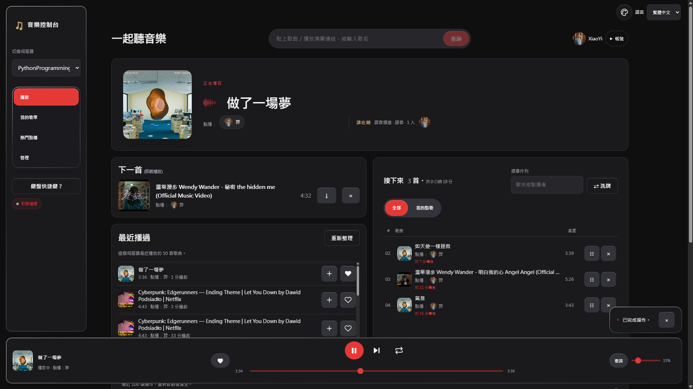
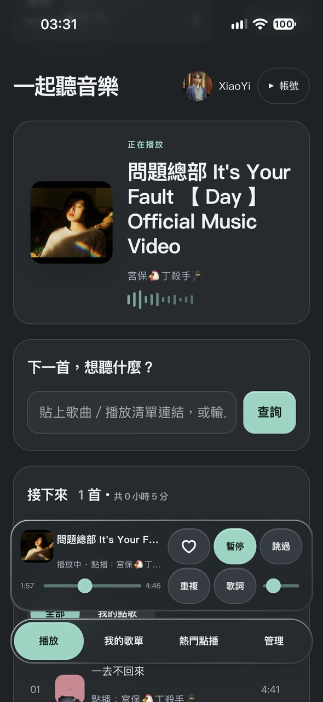

# MusicBot＋網頁控制台 · MusicBot + Web Dashboard

[](https://github.com/chy1211/MusicBot/actions/workflows/ci.yml)
[](https://github.com/chy1211/MusicBot/actions/workflows/docker.yml)
[](https://github.com/chy1211/MusicBot/pkgs/container/musicbot)
[](LICENSE)

點擊下方語言展開或收合 · Click a language to expand or collapse

<details open>
<summary><h2>繁體中文</h2></summary>

這是一個基於經典 [Just-Some-Bots MusicBot](https://github.com/Just-Some-Bots/MusicBot) 改造的專案。我們為它加上了現代化的**網頁控制台**，讓 Discord 伺服器裡的每個人都能直接用電腦瀏覽器或手機輕鬆點歌。透過 Docker，只需要幾分鐘就能快速架設完成。

伺服器成員只要用自己的 Discord 帳號登入網頁，就能找歌、排歌、拖曳調整順序或控制播放，**再也不用背一堆文字指令**。同時，機器人在 Discord 裡的傳統指令玩法也完全保留，網頁端更直接沿用了原本的權限群組與限制設定，無痛接軌。



## 特色功能

**多人同步一起聽**
- **即時播放控制列**：拉動進度條、暫停、切歌、循環播放、調整音量，所有人的畫面都會即時同步。
- **直覺點歌**：貼上網址或輸入歌名，可以先預覽再加入待播清單，或是直接「插播」到下一首。
- **清單管理**：待播清單支援拖曳排序、搜尋、隨機打亂；手滑刪錯歌也能一鍵復原。
- **點歌通知**：有人從網頁點歌時，機器人會在 Discord 的音樂頻道發送通知，大家都能看到是誰點的歌。

**歌單與音樂探索**
- **匯入外部歌單**：支援匯入公開的 Spotify、YouTube／YouTube Music 歌單與合輯，還能自己勾選要加入哪幾首。
- **個人化收藏**：每位成員都擁有自己獨立的私房歌單與最愛收藏。
- **電台模式與排行榜**：提供伺服器熱門點播、最近播放紀錄，以及待播清單播完後「自動接歌」的電台模式（成員主動點的歌，優先度永遠高於電台推薦）。

**動態歌詞**
- **即時同步歌詞**：串接 [LRCLIB](https://lrclib.net) 歌詞庫，個人可自由開關（預設關閉）。
- **時間軸校正**：遇到 MV 前奏太長導致歌詞對不上時，系統會嘗試自動校正；任何人也都能手動微調或一鍵對時。

**手機優化與系統管理**
- **類 App 體驗**：支援 PWA，可「加入主畫面」當作手機 App 使用，介面專為單手操作優化。
- **外觀與語系**：支援深色／淺色主題、繁體中文／英文介面，每個人都能自由切換並自動記憶偏好。
- **安全登入機制**：登入狀態保留 30 天並儲存於伺服器端，支援一鍵登出所有裝置。
- **伺服器獨立設定**：可針對不同伺服器個別設定「是否需要投票切歌」（關閉時，有權限的人按一下就直接切歌）以及網頁點歌通知的備用頻道。
- **管理員後台**：擁有者專屬頁面，可管理權限、自動播放清單，並檢視系統維護狀態。
- **熱更新支援**：更新 YouTube Cookie 時不需重啟機器人，音樂播放不中斷。



## 快速安裝（Docker）

你需要一台 Linux 主機（支援 amd64 或 arm64 架構，包含 64 位元樹莓派），並預先裝好 Docker 與 Compose v2.20 以上版本；或者也可以直接使用 Docker Desktop。

```sh
mkdir musicbot && cd musicbot
curl -fsSLO https://raw.githubusercontent.com/chy1211/MusicBot/dev/docker-compose.yml
curl -fsSL https://raw.githubusercontent.com/chy1211/MusicBot/dev/.env.example -o .env
```

請前往 [Discord Developer Portal (開發者後台)](https://discord.com/developers/applications) 取得以下五個參數，並填入 `.env` 檔案中：

| 環境變數 | 取得方式與說明 |
| --- | --- |
| `DISCORD_BOT_TOKEN` | 進入你的應用程式 > **Bot** > 點擊 Reset Token。請務必同時開啟 **Server Members** 與 **Message Content** 這兩個 Intent 權限。 |
| `DISCORD_CLIENT_ID`／`DISCORD_CLIENT_SECRET` | 進入你的應用程式 > **OAuth2** 頁面即可找到。 |
| `OWNER_ID` | 你自己的 Discord 使用者 ID（在 Discord 設定開啟「開發者模式」> 對自己的頭像按右鍵 > 複製使用者 ID）。 |
| `DASHBOARD_PUBLIC_URL` | 本機測試可填 `http://localhost:8080`，正式上線請填寫你的 HTTPS 網址；同時記得到後台的 **OAuth2 > Redirects** 新增 `<你的網址>/auth/callback`。 |

如果想讓介面預設為繁體中文，且時間顯示為台灣時區，可以在 `.env` 加上：

```sh
DEFAULT_LANGUAGE=zh-TW
TIME_ZONE=Asia/Taipei
```

接著啟動服務：

```sh
docker compose up -d
```

打開瀏覽器進入控制台網址，用 Discord 帳號登入。接著進到語音頻道輸入 `/summon` 把機器人叫進來就可以開始用了！（如果你的控制台網址是 HTTPS，機器人進語音頻道時也會貼心地在聊天室附上點歌網址）。

更完整的架設教學請參考 **[docs/install.zh-TW.md](docs/install.zh-TW.md)**，裡面有邀請機器人、使用內建 Caddy 設定 HTTPS、掛載 Cookie 以及常見問題排解的詳細說明。

### 更新方式

```sh
docker compose pull && docker compose up -d
```

所有的設定檔、歌單與登入狀態都會保存在掛載出來的 `config/` 與 `data/` 資料夾中，更新後資料不會消失。此外，我們的 Docker 映像檔（Image）每週都會自動打包最新版的 yt-dlp。

## 注意事項

- **YouTube 防機器人驗證**：Docker Compose 內建了 [bgutil PO token 服務](https://github.com/Brainicism/bgutil-ytdlp-pot-provider)，能協助繞過 YouTube 的阻擋，但無法保證 100% 成功。若遇到「Sign in to confirm you're not a bot」錯誤，請參考安裝說明中的 Cookie 設定章節。
- **連線安全性**：網頁控制台預設僅監聽本機的 `127.0.0.1`。如果要公開分享給其他人使用，請務必掛上 HTTPS（可使用內建的 Caddy 反向代理）。請妥善保管 `.env`、`config/` 與 `data/` 資料夾，切勿外流。
- **網頁端點歌限制**：為了安全起見，網頁端只接受特定平台的網址（如 YouTube、YouTube Music、Spotify、SoundCloud、Bandcamp 等 yt-dlp 原生支援的服務）以及關鍵字搜尋。一般網頁、直連音檔網址、純 IP 或內網位址都會被系統擋下；每次解析也有時間與流量上限（可於 `web_dashboard.ini` 的 `ResolveTimeoutSeconds` 等參數調整）。
- **Discord 指令安全性**：文字指令 `!play <網址>` 維持了原版行為，這代表它允許機器人去抓取任意網址（包含主機所在的內網位址）。如果你的機器人會開放給不認識的人使用，建議到 `config/permissions.ini` 將該群組 `Extractors` 裡的 `generic` 移除，或是只把指令點歌權限交給信任的成員。
- **傳統指令支援**：Discord 內的指令與原版 MusicBot 完全相同，並額外支援了斜線指令（Slash Commands），詳情請見[原版指令列表](https://just-some-bots.github.io/MusicBot/using/commands/)與 [`config/example_options.ini`](config/example_options.ini)。
- **不想用 Docker 嗎？** 你也可以照原版的方式在本地環境直接執行（需安裝 Python 3.10–3.13、ffmpeg、Deno），再到 `config/web_dashboard.ini` 手動開啟控制台功能，詳見 [docs/web-dashboard.md](docs/web-dashboard.md)。

## 專案現況

詳細的版本更新紀錄請見 [CHANGELOG](CHANGELOG.md)。

這是一個**非官方**的個人分支專案（Fork），與 Just-Some-Bots 官方無關。目前由我利用業餘時間獨立維護，雖然會盡力處理問題，但無法保證即時回覆，還請多多包涵。

由於原版專案目前的更新步調較慢（`dev` 分支最後更新於 2026 年 3 月，`master` 自 2024 年 11 月起便未再變動），這個 Fork 以原版的 `dev` 分支為基底，額外補上了以下內容：

- 升級 Python 3.12 與導入 Deno 環境（新版 yt-dlp 需要它們才能正常解析 YouTube）
- 支援 Discord 斜線指令（Slash Commands）
- 全新的網頁控制台、Docker 一鍵部署配置，以及完整的繁體中文在地化

## 致謝與授權

本專案 Fork 自 [Just-Some-Bots/MusicBot](https://github.com/Just-Some-Bots/MusicBot)，機器人核心功能皆出自原作者，非常感謝原作者與所有開源貢獻者的付出。網頁控制台、Docker 部署架構與繁中翻譯則是由本分支額外開發新增。

本專案沿用原版的 [MIT 授權條款](LICENSE)。

如果使用上遇到任何 Bug，或是有新功能的點子，都非常歡迎開 Issue 討論或直接發 Pull Request！

</details>

<details>
<summary><h2>English</h2></summary>

The classic [Just-Some-Bots MusicBot](https://github.com/Just-Some-Bots/MusicBot), plus a web dashboard that everyone in your Discord server can use from a browser or phone. Install it with Docker in a few minutes.

Members sign in with their Discord account, then search, queue, reorder and control playback without typing commands. The bot still works exactly as before in Discord, and the dashboard follows the same permission groups and limits.


## Features

**Listening together**
- Live now-playing bar with seek, pause, skip, repeat and volume, synced to everyone in real time
- Paste a link or type a song name, preview the result, then add it to the queue or play it next
- Drag to reorder the queue, search it, shuffle it, undo a removal
- Discord notifications in your music channel when someone queues from the web

**Playlists and discovery**
- Import public Spotify and YouTube / YouTube Music playlists and mixes, choosing which tracks to add
- Personal playlists and favorites for each member
- Server "popular requests", recent plays, and a radio mode that keeps the music going when the queue runs out; songs members request always play before the radio picks

**Lyrics**
- Optional synced lyrics (off by default for each person), from [LRCLIB](https://lrclib.net)
- Automatic timing for music videos with long intros, plus manual nudge and "sync now" controls for any member

**Built for phones and teams**
- Installable as a phone app (PWA), with a layout made for one-handed use
- Light and dark themes with a one-tap switch that remembers your choice
- English and Traditional Chinese, with a per-person language switch
- Stay signed in for 30 days; sessions are stored server-side and can be signed out everywhere
- Owner pages for permissions, the autoplaylist and read-only maintenance status
- Per-server settings: turn vote-to-skip off (anyone with skip permission skips instantly) and pick a fallback channel for web request notifications
- YouTube cookies reload without restarting the bot, so music keeps playing


## Quick start (Docker)

You need a Linux machine (amd64 or arm64, including Raspberry Pi 64-bit) with Docker and Compose v2.20+, or Docker Desktop.

```sh
mkdir musicbot && cd musicbot
curl -fsSLO https://raw.githubusercontent.com/chy1211/MusicBot/dev/docker-compose.yml
curl -fsSL https://raw.githubusercontent.com/chy1211/MusicBot/dev/.env.example -o .env
```

Fill in `.env` with five values from the [Discord Developer Portal](https://discord.com/developers/applications):

| Variable | Where to find it |
| --- | --- |
| `DISCORD_BOT_TOKEN` | Your app > **Bot** > Reset Token (also enable **Server Members** and **Message Content** intents) |
| `DISCORD_CLIENT_ID` / `DISCORD_CLIENT_SECRET` | Your app > **OAuth2** |
| `OWNER_ID` | Your own Discord user ID (Developer Mode > right-click your profile > Copy User ID) |
| `DASHBOARD_PUBLIC_URL` | `http://localhost:8080` to try it locally, or your HTTPS domain. Add `<this URL>/auth/callback` under **OAuth2 > Redirects** |

Then start it:

```sh
docker compose up -d
```

Open the dashboard URL, sign in with Discord, join a voice channel and run `/summon`. With an HTTPS dashboard URL, the bot also posts the link in the chat when it joins.

The full guide, including inviting the bot, HTTPS with the bundled Caddy profile, cookies and troubleshooting, is in **[docs/install.md](docs/install.md)**.

### Upgrading

```sh
docker compose pull && docker compose up -d
```

Your settings, playlists and login sessions live in the mounted `config/` and `data/` folders and survive upgrades. Images are rebuilt every week with the current yt-dlp.

## Good to know

- **YouTube bot checks.** The Compose file includes the [bgutil PO token provider](https://github.com/Brainicism/bgutil-ytdlp-pot-provider), which helps with YouTube's checks but cannot guarantee every request gets through. If you see "Sign in to confirm you're not a bot", see the cookies section of the install guide.
- **Security.** The dashboard listens on `127.0.0.1` only by default. Put it behind HTTPS (Caddy is included as an option) before sharing it. Keep `.env`, `config/` and `data/` private.
- **The dashboard only accepts known services.** Links from services with a dedicated yt-dlp extractor (YouTube, YouTube Music, Spotify, SoundCloud, Bandcamp and others) and plain searches work. Generic websites, direct media URLs, IP addresses and private addresses are rejected, and each lookup has time and size limits (`ResolveTimeoutSeconds` and related keys in `web_dashboard.ini`).
- **Discord commands keep upstream behavior.** `!play <url>` can still make the bot fetch any URL, including addresses on its own network. If people you don't know can use the bot, remove `generic` from `Extractors` for their group in `config/permissions.ini` (this blocks playback, though the bot may still fetch the URL once), or only give queue permissions to people you trust.
- **Discord commands** are unchanged from upstream MusicBot, plus slash commands. See the [upstream command list](https://just-some-bots.github.io/MusicBot/using/commands/) and [`config/example_options.ini`](config/example_options.ini).
- **Not using Docker?** You can still run it like upstream MusicBot (Python 3.10–3.13, ffmpeg, Deno) and enable the dashboard in `config/web_dashboard.ini`. See [docs/web-dashboard.md](docs/web-dashboard.md).

## Project status

See [CHANGELOG](CHANGELOG.md) for release changes.

This is an **unofficial**, personal fork. It is not affiliated with Just-Some-Bots. One person maintains it in their spare time, on a best-effort basis, with no guaranteed response time.

Upstream development has slowed down: its `dev` branch was last updated in March 2026, and `master` has not changed since November 2024. This fork builds on upstream `dev` and adds:

- Python 3.12 and Deno, which current yt-dlp needs to play YouTube reliably
- Slash commands
- The web dashboard, Docker packaging and a Traditional Chinese translation

Fixes that make sense for everyone are offered back upstream ([#2481](https://github.com/Just-Some-Bots/MusicBot/pull/2481), [#2482](https://github.com/Just-Some-Bots/MusicBot/pull/2482), [#2483](https://github.com/Just-Some-Bots/MusicBot/pull/2483)). If upstream becomes active again, this fork will follow it.

## Credits and license

This project is a fork of [Just-Some-Bots/MusicBot](https://github.com/Just-Some-Bots/MusicBot), which provides the Discord bot itself. Many thanks to its authors and contributors. The web dashboard, Docker packaging and translations were added in this fork.

Released under the [MIT License](LICENSE), the same license as upstream.

Issues and pull requests are welcome.

</details>
