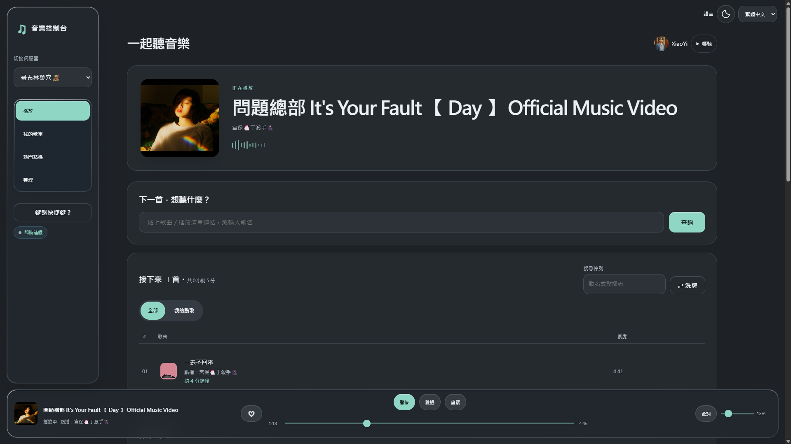
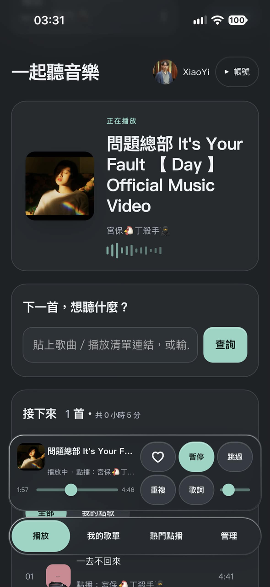

# MusicBot＋網頁控制台

[](https://github.com/chy1211/MusicBot/actions/workflows/ci.yml)
[](https://github.com/chy1211/MusicBot/actions/workflows/docker.yml)
[](https://github.com/chy1211/MusicBot/pkgs/container/musicbot)
[](LICENSE)

[English](README.md) · **繁體中文**

經典的 [Just-Some-Bots MusicBot](https://github.com/Just-Some-Bots/MusicBot)，加上一個網頁控制台，讓 Discord 伺服器裡的每個人都能用瀏覽器或手機點歌。用 Docker 幾分鐘就能裝好。

成員用自己的 Discord 帳號登入，就能查歌、排隊、拖曳排序、控制播放，不用打指令。機器人在 Discord 裡的用法完全不變，網頁也沿用同一套權限群組與限制。



## 功能

**一起聽**
- 正在播放列：拖進度、暫停、跳過、重複、音量，所有人畫面即時同步
- 貼連結或打歌名，先預覽再加入佇列，或插到下一首
- 佇列可拖曳排序、搜尋、洗牌，刪錯了可以復原
- 有人從網頁點歌時，在音樂頻道發 Discord 通知

**歌單與探索**
- 匯入公開的 Spotify、YouTube／YouTube Music 歌單與合輯，可勾選要加哪幾首
- 每位成員都有自己的歌單與收藏
- 伺服器熱門點播、最近播放，以及佇列播完時自動接歌的電台模式；成員點的歌一律排在電台選的歌前面

**歌詞**
- 同步歌詞，每個人預設關閉，來源為 [LRCLIB](https://lrclib.net)
- MV 前奏較長時會自動對時，所有成員都能手動微調或一鍵對時

**手機與多人使用**
- 可加到手機主畫面當 App 用（PWA），版面為單手操作設計
- 淺色與深色主題，一鍵切換並記住你的選擇
- 英文與繁體中文介面，每個人可自己切換
- 登入可保持 30 天，登入狀態存在伺服器端，可一鍵登出所有裝置
- 擁有者專用頁面：權限、自動播放清單、唯讀維護狀態
- 每個伺服器可分別設定：要不要投票跳過（關閉時有跳過權限的人按一次就跳）、網頁點歌通知的備用頻道
- 更新 YouTube cookie 時不用重開機器人，不會斷歌



## 快速安裝（Docker）

需要一台 Linux 機器（amd64 或 arm64，包含 64 位元樹莓派），裝好 Docker 與 Compose v2.20 以上；或使用 Docker Desktop。

```sh
mkdir musicbot && cd musicbot
curl -fsSLO https://raw.githubusercontent.com/chy1211/MusicBot/dev/docker-compose.yml
curl -fsSL https://raw.githubusercontent.com/chy1211/MusicBot/dev/.env.example -o .env
```

到 [Discord 開發者入口](https://discord.com/developers/applications) 取得五個值，填進 `.env`：

| 變數 | 在哪裡找 |
| --- | --- |
| `DISCORD_BOT_TOKEN` | 你的應用程式 > **Bot** > Reset Token，同時開啟 **Server Members** 與 **Message Content** 兩個 intent |
| `DISCORD_CLIENT_ID`／`DISCORD_CLIENT_SECRET` | 你的應用程式 > **OAuth2** |
| `OWNER_ID` | 你自己的 Discord 使用者 ID：開啟開發者模式 > 右鍵自己的頭像 > 複製使用者 ID |
| `DASHBOARD_PUBLIC_URL` | 本機試用填 `http://localhost:8080`，正式使用填你的 HTTPS 網域；並在 **OAuth2 > Redirects** 加入 `<這個網址>/auth/callback` |

想讓介面預設中文、時間用台灣時區，可以再加上：

```sh
DEFAULT_LANGUAGE=zh-TW
TIME_ZONE=Asia/Taipei
```

然後啟動：

```sh
docker compose up -d
```

打開控制台網址，用 Discord 登入，進入語音頻道後執行 `/summon`。控制台網址是 HTTPS 時，機器人進語音也會在聊天室貼出網址。

完整說明在 **[docs/install.zh-TW.md](docs/install.zh-TW.md)**，包含邀請機器人、用內建的 Caddy 設定 HTTPS、cookie 與疑難排解。

### 更新

```sh
docker compose pull && docker compose up -d
```

設定、歌單與登入狀態存在掛載的 `config/`、`data/` 資料夾，更新後都會保留。映像每週會用最新的 yt-dlp 重新建置。

## 注意事項

- **YouTube 機器人檢查**：Compose 內含 [bgutil PO token 服務](https://github.com/Brainicism/bgutil-ytdlp-pot-provider)，能幫忙通過 YouTube 的檢查，但無法保證每次成功。如果出現「Sign in to confirm you're not a bot」，請看安裝說明的 cookie 章節。
- **安全性**：控制台預設只聽 `127.0.0.1`。要分享給別人用之前，請放在 HTTPS 後面（可選用內建的 Caddy）。`.env`、`config/`、`data/` 都不要外流。
- **網頁點歌只接受特定網站**：YouTube、YouTube Music、Spotify、SoundCloud、Bandcamp 等 yt-dlp 有專屬支援的服務，以及關鍵字搜尋。一般網站、直接的音檔網址、IP 與內網位址都會被拒絕；每次解析有時間與流量上限（`web_dashboard.ini` 的 `ResolveTimeoutSeconds` 等設定）。
- **Discord 指令維持原版行為**：`!play <網址>` 仍可讓機器人去抓任意網址，包括它所在網路裡的位址。如果機器人會給不熟的人用，請到 `config/permissions.ini` 把該群組 `Extractors` 裡的 `generic` 拿掉（會擋下播放，但機器人可能仍會先連一次該網址），或只讓信任的人有點歌權限。
- **Discord 指令**與原版 MusicBot 相同，另外加上斜線指令，見[原版指令列表](https://just-some-bots.github.io/MusicBot/using/commands/)與 [`config/example_options.ini`](config/example_options.ini)。
- **不想用 Docker？** 也可以照原版 MusicBot 的方式執行（Python 3.10–3.13、ffmpeg、Deno），再到 `config/web_dashboard.ini` 開啟控制台，見 [docs/web-dashboard.md](docs/web-dashboard.md)。

## 專案狀態

這是**非官方**的個人 fork，和 Just-Some-Bots 沒有關係，由一個人在空閒時維護，盡力而為，不保證回應時間。

原版目前更新得很慢（`dev` 分支最後一次更新是 2026 年 3 月，`master` 自 2024 年 11 月起沒有再變動）。這個 fork 以原版 `dev` 為基礎，另外補上：

- Python 3.12 與 Deno：新版 yt-dlp 需要它們才能正常播放 YouTube
- 斜線指令
- 網頁控制台、Docker 打包與繁體中文翻譯

能通用的修正會送回原版（[#2481](https://github.com/Just-Some-Bots/MusicBot/pull/2481)、[#2482](https://github.com/Just-Some-Bots/MusicBot/pull/2482)、[#2483](https://github.com/Just-Some-Bots/MusicBot/pull/2483)）。如果原版恢復活躍，這個 fork 會跟著同步。

## 致謝與授權

本專案 fork 自 [Just-Some-Bots/MusicBot](https://github.com/Just-Some-Bots/MusicBot)，Discord 機器人本體出自原作者，感謝原作者與所有貢獻者。網頁控制台、Docker 打包與翻譯是這個 fork 新增的。

授權與原版相同，採 [MIT 授權](LICENSE)。

歡迎開 issue 或送 pull request。
